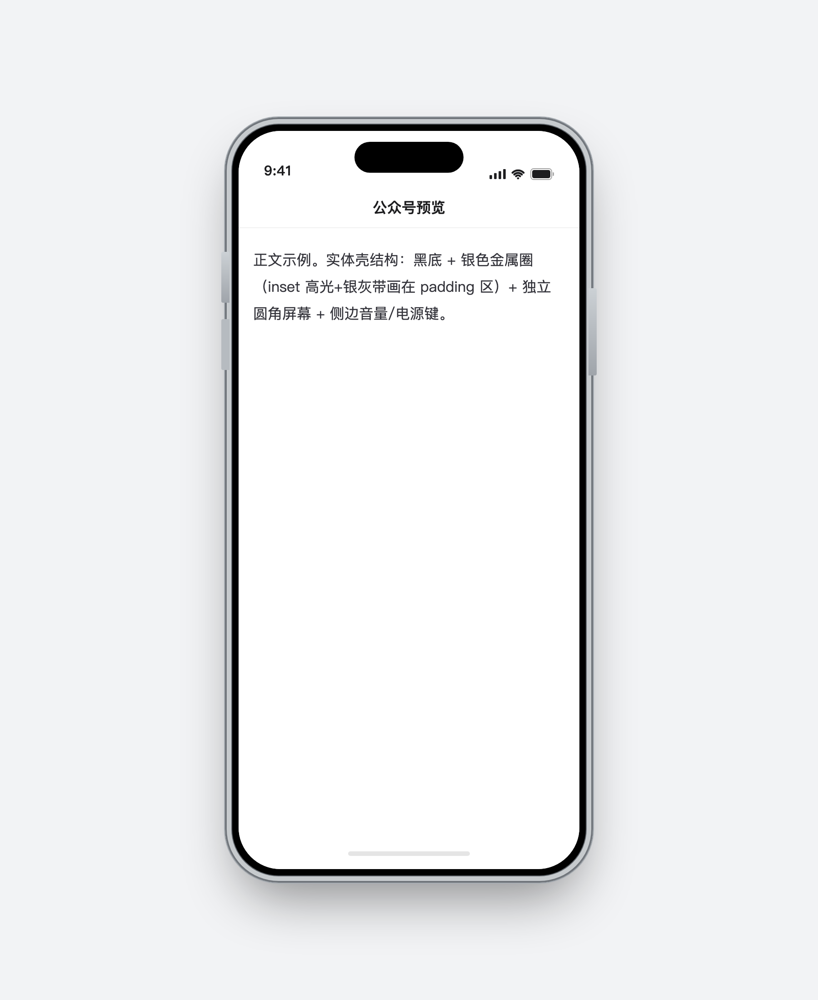

# 公众号发布 · WeChat Publish for Obsidian

在 Obsidian 里写微信公众号文章：**实时预览手机端排版 → 一键复制粘贴 / 推送到草稿箱**。

Write WeChat Official Account (公众号) articles in Obsidian with a live phone-frame preview, paste-safe rich HTML output, and one-click push to your draft box.



## 功能 · Features

- 📱 **手机壳实时预览**：金属边框 iPhone 样式预览面板，所见即所得
- 🎨 **16 套排版主题**：Dia 渐变系列 12 款（珊瑚粉 / 极光蓝紫 / 青碧 / 落日橙 / 海青 / 葡萄紫 / 莫兰迪×3 / 单色×3）+ 卡兹克 / 百年孤独 / 朱砂笺 / 陶笺
- 🏮 **陶笺主题**：暖象牙白纸面 + 陶土点缀，H1 自动眉题（PART ONE · 开 篇 → 拂晓/日升/亭午/斜阳/灯下 → PART END · 终 章）、`==高亮==`、引用竖线 + `——` 出处小字，安卓/iOS 字重统一
- ✨ **AI 排版**：接入 GLM 等大模型自动重排结构——拆段、金句引用、高亮、拟标题，**原句逐字校验不改写**，预览内原文/AI 对比切换、一键写回；常驻进度条 + 四轮自动修复
- 🧩 **可切换样式组件**：一级标题 6 种装饰（渐变竖条 / 播放三角 / 右向箭头 / 渐变方块 / 填色标签条 / 渐变文字）、引用块 4 种（渐变卡片 / 大引号 / 左粗边 / 卡片+引号）、分割线 3 种（渐变短条 / 三点渐变 / 渐隐线）
- 🔒 **粘贴安全**：所有样式针对微信编辑器的 HTML 清洗规则设计，粘贴后不散架（flex 卡片、渐变底、圆角均实测存活），卡片内行内元素化防广告插入
- 🖼 **图片自动内嵌**：笔记中的本地图片（含 `![[嵌入]]`）自动转 base64 随文推送
- ✍️ 盘古之白（中英文间自动加空格）、标题居中、字号字距、侧边距等细节设置

## 安装 · Installation

### 方式一：BRAT（推荐，无需等市场审核）

1. 安装 [BRAT](https://github.com/TfTHacker/obsidian42-brat) 插件
2. BRAT 设置 → `Add Beta plugin` → 填入本仓库地址 `youbai-Felix/wechat-publish`
3. 在第三方插件列表启用「公众号发布」

### 方式二：手动安装

1. 下载 [最新 Release](../../releases) 中的 `main.js`、`manifest.json`、`styles.css`
2. 放入笔记库 `.obsidian/plugins/wechat-publish/` 目录
3. 重启 Obsidian 并启用插件

### 方式三：社区市场（审核中）

上架后可直接在 设置 → 第三方插件 → 社区插件 搜索「公众号发布」。

## 服务端部署（推送草稿箱需要）· Self-host the push server

微信草稿箱 API 需要公众号 AppSecret 调用，且 `access_token` 有 IP 白名单限制，因此**推送到草稿箱需要一个极简自部署服务**（本仓库 [`server/`](server/) 目录，约 100 行，仅依赖 express + cors）。只使用「复制 HTML 手动粘贴」的话无需部署。

```bash
cd server
npm install

# 配置你的公众号凭据（公众号后台 → 设置与开发 → 基本配置）
export WX_APP_ID=wx你的appid
export WX_APP_SECRET=你的secret
export WX_THUMB_MEDIA_ID=封面图media_id   # 可选，用于草稿封面
export PORT=3000

npm start
```

然后在 Obsidian 插件的「同步到微信草稿箱」弹窗里把 API 地址填为 `http://你的服务器:3000/api/wechat/draft`。

> ⚠️ 凭据只通过环境变量注入，不要写进代码或提交到 git。服务仅供自用，不要暴露到公网未加防护的环境。

## 使用 · Usage

1. 打开一篇 Markdown 笔记 → 侧栏「公众号预览」（或命令面板 `打开公众号预览`）
2. 浮动设置面板选择主题、样式组件、字体字号
3. `复制 HTML` → 粘贴到公众号编辑器；或 `同步草稿箱` → 一键推送
4. 引用块末行以 `—` 或 `--` 开头会渲染为右对齐署名，如：
   ```markdown
   > 排版的终极目标，是让读者忘记排版的存在。
   > — 某某设计原则
   ```

## AI 排版 · AI Typesetting

工具栏 ✨ 按钮：大模型自动重排结构（拆段 / 金句引用 / 高亮 / 拟标题），**原句逐字校验、绝不改写**；预览内「原文 ⇄ AI 排版」对比，满意一键写回。需要在设置里配置（OpenAI 兼容协议）：

- **GLM Coding Plan 订阅 Key**：API 地址填 `https://open.bigmodel.cn/api/anthropic/v1/messages`（走订阅额度）
- **按量付费 Key**：API 地址填 `https://open.bigmodel.cn/api/paas/v4/chat/completions`
- 模型如 `glm-5.3` / `glm-5.3-flash`

## 开发 · Development

```bash
npm install
npm run dev   # 开发构建
npm run build # 产出 main.js
```

## License

[MIT](LICENSE)
